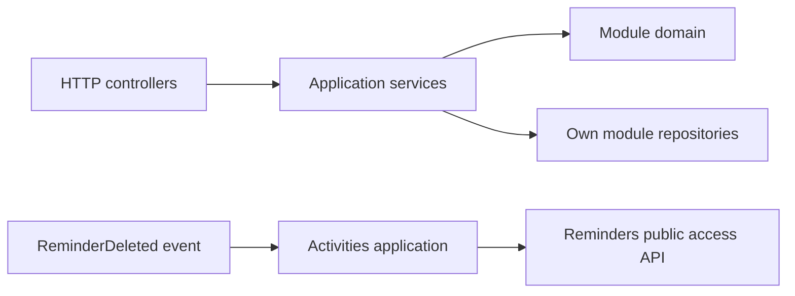

# Module boundaries

DailyReminder is one Spring Boot process and one PostgreSQL database, organized by business capability.

| Module package | Responsibility | Public integration points |
| --- | --- | --- |
| `modules.users` | Identity, credentials, verification, recovery, token rotation | `IdentityService`, `TokenJwtService` |
| `modules.activities` | Activity planning, completion, ownership | `ActivityUseCase` |
| `modules.notes` | Personal reminders, schedules, recurrence | `ReminderAccess`, `ReminderDeleted` |

The `notes` and `users` names are retained for compatibility with the existing project structure.
They represent the Reminders and Identity modules respectively.

Controllers validate transport requests, identify the current user, and map responses. They do not
query repositories or coordinate transactions. Application services own business decisions,
ownership checks, and transactions. Domain classes do not depend on HTTP or controllers.

Module relationships use UUIDs rather than cross-module JPA entity associations. Activities
validate reminder ownership through `ReminderAccess`. Deleting a reminder publishes an in-process
`ReminderDeleted` event in the same transaction; the Activities module detaches its links before
the reminder is removed. A failure rolls back both changes.

ArchUnit tests enforce acyclic modules, domain independence, controller/repository separation,
and prevent Activities from importing Reminder persistence or Identity internals. These tests
are part of `sh mvnw test`. This is an architectural foundation, not a microservice split.

# Testing strategy

- Domain tests: recurrence boundaries, selected weekdays, daylight-saving changes.
- Application tests: ownership, completion timestamps, mutations without optional reminders.
- HTTP/PostgreSQL tests: account lifecycle, activity/reminder CRUD, relationship preservation,
  recurrence idempotency, token rotation, password-reset session revocation, verification.
- Architecture tests: module dependencies and layer boundaries.

Integration tests roll back business records. Flyway migrations are applied to the configured
database and remain applied. Email delivery is mocked for recovery tests.

# Time and recurrence

Activity dates are calendar dates. Reminder instants are stored with an IANA timezone and a
recurrence rule. Completing a recurring reminder advances its schedule, preserves the local
wall-clock time through daylight-saving changes, and skips missed occurrences. The submitted
occurrence timestamp prevents retries from advancing the same reminder twice.

Browser notifications are a frontend capability while the app is open. The backend does not
currently dispatch background push notifications or reminder emails.
